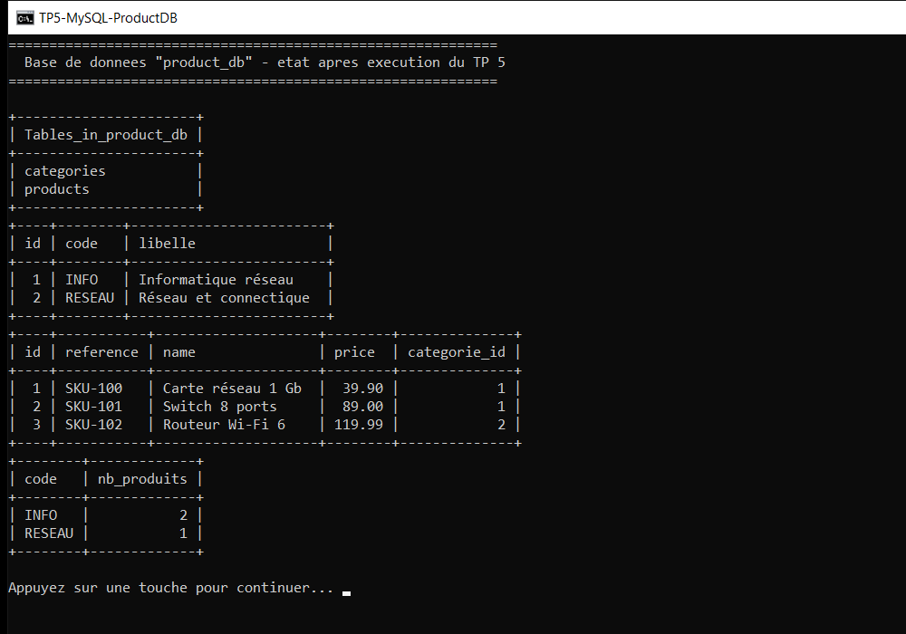

# TP 5 — Intégration de Spring et Hibernate dans une architecture microservices

Confier à **Spring** le câblage des objets (`DataSource`, `SessionFactory`, DAO, services) et
la **gestion déclarative des transactions**, Hibernate ne s'occupant plus que du mapping
objet-relationnel.

> Lab du cours *Architecture Microservices : Conception, Déploiement et Orchestration* (MLIAEdu).
> Stack : Spring Framework 5.3.39 (context, orm, tx) · Hibernate ORM 5.6.15.Final · `javax.persistence` 2.2 · MySQL Connector/J 8.0.33 · JUnit 5 + `spring-test`.
> Base : MySQL/MariaDB locale (`product_db`).

## Résultat attendu (exécution réelle)

Début de l'exécution — démarrage du conteneur Spring et vérification du câblage :


Fin de l'exécution — dernières étapes et bilan :


Le scénario `mliaedu.tp5.CatalogueDemo` démarre le conteneur Spring, récupère les bean
`ProductService` / `CategorieService` par injection, puis déroule sept étapes contre la vraie
base en comparant, à chaque fois, la valeur attendue et la valeur réellement obtenue :

| Étape | Vérification | Attendu | Obtenu |
|-------|--------------|---------|--------|
| 0 | Bean de configuration enregistré dans le contexte | déclaré | `20 bean(s)` |
| 0 | Fabrique de sessions exposée par Spring | `SessionFactory` | `SessionFactoryImpl` |
| 0 | Gestionnaire de transactions | `HibernateTransactionManager` | `HibernateTransactionManager` |
| 0 | Proxy transactionnel sur `ProductService` | `ProductServiceImpl` | `ProductServiceImpl` |
| 0 | Proxy transactionnel sur `CategorieService` | `CategorieServiceImpl` | `CategorieServiceImpl` |
| 0 | Connexion JDBC réellement ouverte | MySQL/MariaDB | `MySQL 5.5.5-10.4.32-MariaDB` |
| 1 | Purge des produits (remise à zéro) | table vide | `0` |
| 1 | Purge des rayons (remise à zéro) | table vide | `0` |
| 2 | Rayons persistés par `CategorieService` | 2 | 2 |
| 2 | Produits persistés par `ProductService` | 4 | 4 |
| 2 | Identifiant généré par la base | `1` | `1` |
| 2 | Association `@ManyToOne` : rayon du produit | `INFO` | `INFO` |
| 3 | Relecture par référence (`parReference`) | `Routeur Wi-Fi 6` | `Routeur Wi-Fi 6` |
| 3 | Mise à jour du prix (`modifierPrix`) | `119.99` | `119.99` |
| 3 | Taille du catalogue (`compter`) | 4 | 4 |
| 3 | Produits au-dessus de 80 EUR (`plusChersQue`) | 2 | 2 |
| 3 | Prix moyen (`avg`) | `65.35` | `65.35` |
| 4 | Produits d'un rayon (`duRayon`) | 2 | 2 |
| 4 | Répartition par rayon (`group by`) | `INFO=2, RESEAU=2` | `INFO=2, RESEAU=2` |
| 4 | `left join fetch` : collections initialisées hors session | 4 produits | 4 |
| 4 | Produits lus via `Categorie.getProduits()` | 2 | 2 |
| 4 | Requête de comptage générique `IDao<T>.compter()` | 2 | 2 |
| 5 | Prix négatif refusé | `IllegalArgumentException` | `Le prix ne peut pas être négatif : -1.0` |
| 5 | Référence déjà utilisée refusée | `IllegalArgumentException` | `La référence SKU-100 est déjà utilisée` |
| 5 | Rayon inconnu refusé | `IllegalArgumentException` | `Le rayon INCONNU n'existe pas` |
| 5 | Import en lot : une ligne invalide annule tout | `IllegalArgumentException` | `Le prix ne peut pas être négatif : -5.0` |
| 5 | Nombre de produits après l'échec du lot | 4 | 4 |
| 5 | Contrainte `uk_product_reference` + rollback Spring | insertion refusée, `produits=4` | idem |
| 5 | Aucune ligne partielle en base | 4 | 4 |
| 6 | Suppression d'un produit | `true` | `true` |
| 6 | Catalogue après suppression | 3 | 3 |
| 6 | Rayon non vide protégé | `IllegalStateException` | `Le rayon INFO contient encore 2 produit(s)` |
| 6 | Rayon vide supprimé | `true` | `true` |
| 6 | Rayons restants | 2 | 2 |
| — | **Total** | **34 vérifications conformes** | **34 / 34** |

Transcription complète de la sortie console (identique à
[docs/transcription-console.txt](docs/transcription-console.txt)) :

```text

==========================================================================================
 TP 5 - Spring Framework et Hibernate dans un microservice
 Conteneur Spring, DAO generique <T> et transactions declaratives
==========================================================================================
 JDK          : 21.0.9 (Oracle Corporation)
 Spring       : 5.3.39
 Hibernate    : 5.6.15.Final
 Base         : jdbc:mysql://localhost:3306/product_db?useSSL=false&allowPublicKeyRetrieval=true&serverTimezone=UTC&useUnicode=true&characterEncoding=UTF-8
 Configuration: mliaedu.tp5.config.ApplicationConfig (20 beans)
==========================================================================================


[0] Conteneur Spring : injection et câblage des dépendances
--------------------------------------------------------------------------------
  [OK]    Configuration ApplicationConfig enregistrée                | 20 bean(s) déclaré(s)
  [OK]    Fabrique de sessions Hibernate exposée                     | SessionFactoryImpl
  [OK]    Gestionnaire de transactions                               | HibernateTransactionManager
  [OK]    Proxy transactionnel sur ProductService                    | ProductServiceImpl
  [OK]    Proxy transactionnel sur CategorieService                  | CategorieServiceImpl
  [OK]    Connexion JDBC opérationnelle                              | MySQL 5.5.5-10.4.32-MariaDB

[1] Remise à zéro du catalogue
--------------------------------------------------------------------------------
  [OK]    Produits restants après purge                              | 0
  [OK]    Rayons restants après purge                                | 0

[2] Création des rayons puis des produits (couche service)
--------------------------------------------------------------------------------
  rayons créés      -> Categorie#1 INFO "Informatique réseau" | Categorie#2 RESEAU "Réseau et connectique"
  produits créés    -> 4 lignes
  [OK]    Rayons persistés                                           | 2
  [OK]    Produits persistés                                         | 4
  [OK]    Identifiant généré par la base                             | 1
  [OK]    Rayon rattaché au produit                                  | INFO

[3] Lecture, mise à jour et indicateurs
--------------------------------------------------------------------------------
  parReference      -> Product#3 [SKU-102] Routeur Wi-Fi 6 (129.99 EUR, rayon RESEAU)
  [OK]    Produit retrouvé par sa référence                          | Routeur Wi-Fi 6
  [OK]    Nouveau prix enregistré                                    | 119.99
  [OK]    Taille du catalogue                                        | 4
  [OK]    Produits au-dessus de 80 EUR                               | 2
  [OK]    Prix moyen du catalogue                                    | 65.35

[4] Requêtes HQL du DAO générique et jointure
--------------------------------------------------------------------------------
  [OK]    Produits du rayon INFO                                     | 2
  [OK]    Répartition par rayon                                      | INFO=2, RESEAU=2
  [OK]    Rayons chargés avec leurs produits                         | 4
  [OK]    Produits du rayon INFO (via le rayon)                      | 2
  [OK]    Comptage générique du DAO                                  | 2

[5] Validations métier et transactions déclaratives
--------------------------------------------------------------------------------
  [OK]    Prix négatif refusé                                        | IllegalArgumentException : Le prix ne peut pas être négatif : -1.0
  [OK]    Référence déjà utilisée refusée                            | IllegalArgumentException : La référence SKU-100 est déjà utilisée
  [OK]    Rayon inconnu refusé                                       | IllegalArgumentException : Le rayon INCONNU n'existe pas
  [OK]    Import atomique : une ligne invalide annule le lot         | IllegalArgumentException : Le prix ne peut pas être négatif : -5.0
  [OK]    Nombre de produits après rollback du lot                   | 4
[WARN] SQL Error: 1062, SQLState: 23000
[ERROR] Duplicate entry 'SKU-900' for key 'uk_product_reference'
  contrainte SQL    -> Duplicate entry 'SKU-900' for key 'uk_product_reference'
  [OK]    Contrainte d'unicité appliquée et transaction annulée      | insertion en double refusée, produits=4
  [OK]    Aucune ligne partielle après rollback                      | 4

[6] Suppressions et intégrité référentielle
--------------------------------------------------------------------------------
  [OK]    Produit retiré                                             | true
  [OK]    Catalogue après suppression                                | 3
  [OK]    Rayon non vide protégé                                     | IllegalStateException : Le rayon INFO contient encore 2 produit(s)
  [OK]    Rayon vide supprimé                                        | true
  [OK]    Rayons restants                                            | 2

==========================================================================================
 BILAN : 34 vérification(s) conforme(s) sur 34
 État du microservice : conteneur, DAO générique et transactions opérationnels.
==========================================================================================
```

## Vérification côté base



État réel de `product_db` à la fin du scénario (le rayon temporaire créé pour le test de
contrainte a été supprimé, un produit a été retiré) :

```text
+----------------------+
| Tables_in_product_db |
+----------------------+
| categories           |
| products             |
+----------------------+
+----+--------+------------------------+
| id | code   | libelle                |
+----+--------+------------------------+
|  1 | INFO   | Informatique réseau    |
|  2 | RESEAU | Réseau et connectique  |
+----+--------+------------------------+
+----+-----------+--------------------+--------+--------------+
| id | reference | name               | price  | categorie_id |
+----+-----------+--------------------+--------+--------------+
|  1 | SKU-100   | Carte réseau 1 Gb  |  39.90 |            1 |
|  2 | SKU-101   | Switch 8 ports     |  89.00 |            1 |
|  3 | SKU-102   | Routeur Wi-Fi 6    | 119.99 |            2 |
+----+-----------+--------------------+--------+--------------+
+--------+-------------+
| code   | nb_produits |
+--------+-------------+
| INFO   |           2 |
| RESEAU |           1 |
+--------+-------------+
```

## Structure du projet

```text
tp5-spring-hibernate-integration/
├── pom.xml
├── run-demo.cmd                          # lance la démo dans une console UTF-8
├── docs/
│   ├── screenshots/
│   │   ├── console-debut.png           # démarrage du conteneur Spring
│   │   ├── console-bilan.png           # étapes 3 à 6 et bilan
│   │   └── verification-mysql.png
│   └── transcription-console.txt       # sortie console complète
└── src/
    ├── main/java/mliaedu/tp5/
    │   ├── CatalogueDemo.java            # scénario vérifié, code de sortie 0/1
    │   ├── config/
    │   │   ├── PersistanceConfig.java    # DataSource, SessionFactory, TransactionManager
    │   │   └── ApplicationConfig.java    # @ComponentScan + @Import
    │   ├── domaine/
    │   │   ├── Categorie.java            # @OneToMany (LAZY), uk_categorie_code
    │   │   └── Product.java              # @ManyToOne (EAGER), uk_product_reference
    │   ├── dao/
    │   │   ├── IDao.java                 # contrat générique <T>
    │   │   ├── AbstractDao.java          # CRUD unique pour toutes les entités
    │   │   ├── ProductDao.java / ProductDaoImpl.java
    │   │   └── CategorieDao.java / CategorieDaoImpl.java
    │   └── service/
    │       ├── ProductService.java / ProductServiceImpl.java
    │       ├── CategorieService.java / CategorieServiceImpl.java
    │       └── LigneProduit.java         # record d'une ligne d'import
    ├── main/resources/persistance.properties
    └── test/java/mliaedu/tp5/
        ├── support/ContexteDeTest.java   # base commune @Transactional
        ├── config/ConteneurSpringTest.java
        ├── service/ProductServiceTest.java
        └── service/CategorieServiceTest.java
```

## Modèle de données

Deux tables suffisent à illustrer l'association `1..n` **rayon → produits**, cette fois
mappée par annotations et non par un fichier `hibernate.cfg.xml` :

```text
categories                                products
+----+--------+------------------------+   +----+-----------+--------+--------+--------------+
| id | code   | libelle                |   | id | reference | name   | price  | categorie_id |
+----+--------+------------------------+   +----+-----------+--------+--------+--------------+
         ^                                                    |
         +----------------------------------------------------+
                FOREIGN KEY (categorie_id) REFERENCES categories(id)
```

| Contrainte | Rôle |
|------------|------|
| `uk_categorie_code UNIQUE(code)` | deux rayons ne peuvent pas partager le même code |
| `uk_product_reference UNIQUE(reference)` | une référence produit est unique dans le catalogue |
| `FOREIGN KEY (categorie_id)` | un produit ne référence qu'un rayon existant |
| `hibernate.hbm2ddl.auto=update` | les deux tables sont créées au premier démarrage |

```java
@Entity
@Table(name = "categories", uniqueConstraints = @UniqueConstraint(name = "uk_categorie_code", columnNames = "code"))
public class Categorie {
    @Id @GeneratedValue(strategy = GenerationType.IDENTITY)
    private Integer id;

    @OneToMany(mappedBy = "categorie", cascade = CascadeType.PERSIST, fetch = FetchType.LAZY)
    private List<Product> produits = new ArrayList<>();
    // ...
}

@Entity
@Table(name = "products", uniqueConstraints = @UniqueConstraint(name = "uk_product_reference", columnNames = "reference"))
public class Product {
    @Column(precision = 10, scale = 2)
    private BigDecimal price;

    @ManyToOne(fetch = FetchType.EAGER, optional = false)
    @JoinColumn(name = "categorie_id")
    private Categorie categorie;
    // ...
}
```

## Configuration Spring

Trois bean suffisent à brancher Hibernate dans le conteneur :

```java
@Configuration(proxyBeanMethods = false)
@EnableTransactionManagement
@PropertySource("classpath:persistance.properties")
public class PersistanceConfig {

    @Bean
    public DataSource dataSource(@Value("${db.driver}") String pilote, @Value("${db.url}") String url,
                                 @Value("${db.user}") String utilisateur, @Value("${db.password:}") String motDePasse) {
        DriverManagerDataSource source = new DriverManagerDataSource();
        source.setDriverClassName(pilote);
        source.setUrl(url);
        source.setUsername(utilisateur);
        source.setPassword(motDePasse);
        return source;
    }

    @Bean
    public LocalSessionFactoryBean sessionFactory(DataSource dataSource, /* dialecte, hbm2ddl… */) {
        LocalSessionFactoryBean fabrique = new LocalSessionFactoryBean();
        fabrique.setDataSource(dataSource);
        fabrique.setPackagesToScan("mliaedu.tp5.domaine");   // entités découvertes par annotation
        fabrique.setHibernateProperties(proprietes);
        return fabrique;
    }

    @Bean
    public PlatformTransactionManager transactionManager(SessionFactory sessionFactory) {
        HibernateTransactionManager gestionnaire = new HibernateTransactionManager();
        gestionnaire.setSessionFactory(sessionFactory);
        return gestionnaire;
    }
}
```

`ApplicationConfig` ne fait que composer : scan des `@Service` / `@Repository` du paquet
`mliaedu.tp5` et import de la configuration de persistance.

```java
@Configuration(proxyBeanMethods = false)
@ComponentScan(basePackages = "mliaedu.tp5", excludeFilters = @Filter(ANNOTATION, Configuration.class))
@Import(PersistanceConfig.class)
public class ApplicationConfig { }
```

Le filtre d'exclusion évite qu'un `@Configuration` du paquet soit enregistré deux fois
(une fois par le scan, une fois par `@Import`) ; le contexte expose ainsi 20 bean.

## Couche DAO : un seul CRUD pour toutes les entités

Les couches supérieures ne connaissent que `IDao<T>`, jamais `Session`, `Transaction` ni `Query` :

```java
public interface IDao<T> {
    T enregistrer(T entite);
    T mettreAJour(T entite);
    boolean supprimer(Serializable id);
    Optional<T> parId(Serializable id);
    List<T> tous();
    long compter();
}
```

`AbstractDao<T>` en donne **une** implémentation, réutilisée par `ProductDaoImpl` et
`CategorieDaoImpl`. Point clé de l'intégration Spring : la session vient de
`getCurrentSession()` et **aucun `commit` n'apparaît dans le DAO** — c'est le
`HibernateTransactionManager` qui valide ou annule.

```java
protected final Session session() {
    return sessionFactory.getCurrentSession();   // session liée à la transaction Spring
}

@Override
public T enregistrer(T entite) {
    session().persist(entite);
    return entite;
}

@Override
public List<T> tous() {
    return session().createQuery("from " + nomEntite() + " order by id", typeEntite).getResultList();
}
```

## Couche service : transactions déclaratives

```java
@Service
@Transactional                       // une transaction par méthode publique
public class ProductServiceImpl implements ProductService {

    @Override
    public Product ajouter(String reference, String name, double price, String codeCategorie) {
        // validations métier puis productDao.enregistrer(produit)
    }

    @Override
    public int importer(String codeCategorie, List<LigneProduit> lignes) {
        // tout ou rien : la moindre ligne invalide annule le lot entier
    }

    @Override
    @Transactional(readOnly = true)
    public List<Product> catalogue() {
        return productDao.tous();
    }
}
```

Règles métier portées par les services (double barrière : validation applicative *et*
contraintes SQL) : référence obligatoire et unique, prix positif, rayon existant, import
atomique, suppression d'un rayon non vide refusée.

## Requêtes HQL utilisées

| Usage | Requête HQL |
|-------|-------------|
| Lister une entité | `from <Entité> order by id` |
| Compter une entité | `select count(e) from <Entité> e` |
| Produit par référence | `from Product p where p.reference = :reference` |
| Référence déjà prise (insensible à la casse) | `select count(p) from Product p where lower(p.reference) = lower(:reference)` |
| Produits d'un rayon | `from Product p where p.categorie.code = :code order by p.name` |
| Produits au-dessus d'un seuil | `from Product p where p.price > :seuil order by p.price desc` |
| Prix moyen | `select avg(p.price) from Product p` |
| Répartition par rayon | `select c.code, count(p) from Product p join p.categorie c group by c.code order by c.code` |
| Rayon par code | `from Categorie c where lower(c.code) = lower(:code)` |
| Inventaire sans N+1 | `select distinct c from Categorie c left join fetch c.produits order by c.code` |
| Compter les produits d'un rayon | `select count(p) from Product p where p.categorie.id = :id` |

## Prérequis et configuration

1. **JDK 17+** (testé avec JDK 21) et **Maven 3.6+**.
2. **MySQL ou MariaDB** démarré sur le port 3306 (XAMPP, WAMP, MySQL Server…).
3. La base doit exister — Spring/Hibernate créent les tables :

```sql
CREATE DATABASE IF NOT EXISTS product_db
  CHARACTER SET utf8mb4 COLLATE utf8mb4_general_ci;
```

Configuration de la connexion ([src/main/resources/persistance.properties](src/main/resources/persistance.properties)) :

| Propriété | Valeur par défaut |
|-----------|-------------------|
| `db.url` | `jdbc:mysql://localhost:3306/product_db?useSSL=false&allowPublicKeyRetrieval=true&serverTimezone=UTC&useUnicode=true&characterEncoding=UTF-8` |
| `db.user` | `root` |
| `db.password` | *(vide — défaut XAMPP)* |
| `hibernate.dialect` | `org.hibernate.dialect.MySQL8Dialect` |
| `hibernate.hbm2ddl.auto` | `update` |

Aucun identifiant n'est codé en dur : chaque propriété est surchargeable au lancement
(`-Ddb.url=… -Ddb.password=…`), ce qui évite de recompiler le microservice d'un
environnement à l'autre.

## Construire, lancer, tester

```bat
mvn clean package
run-demo.cmd
```

`run-demo.cmd` configure la console en UTF-8 (accents lisibles), recompile si nécessaire et
lance le scénario. Sinon, directement :

```bat
java -Dfile.encoding=UTF-8 -cp "target\classes;target\lib\*" mliaedu.tp5.CatalogueDemo
```

Le scénario renvoie un **code de sortie 0** si les 34 vérifications passent, `1` sinon :
il est donc utilisable tel quel dans une chaîne d'intégration.

Tests de non-régression (JUnit 5 + `spring-test`, base réelle, chaque test est annulé par
rollback) :

```bat
mvn test
```

```text
Tests run: 22, Failures: 0, Errors: 0, Skipped: 0
```

| Classe de test | Couverture |
|----------------|------------|
| `config.ConteneurSpringTest` (6) | bean présents, types réels, injection par constructeur, session unique, transactions activées |
| `service.ProductServiceTest` (9) | création, référence en double, prix négatif, rayon inconnu, import atomique, mise à jour, seuil, moyenne, suppression |
| `service.CategorieServiceTest` (7) | création, code normalisé, code en double, inventaire avec jointure, comptage, suppression protégée, suppression |

> ⚠️ La démo comme les tests **purgent les tables** au démarrage : `product_db` est une
> base de travaux pratiques, pas une base de production.

## Points techniques vérifiés

- **`getCurrentSession()` vs `openSession()`** — avec Spring, le DAO doit utiliser
  `getCurrentSession()` : la session est créée, partagée et fermée par
  `HibernateTransactionManager`. Appeler un DAO **hors** transaction lève
  `Could not obtain transaction-synchronized Session` — c'est précisément la preuve que le
  gestionnaire de transactions est bien branché.
- **Transactions déclaratives** — `@Transactional` sur la classe du service, `readOnly = true`
  sur les lectures. Aucun `beginTransaction`/`commit` dans le code applicatif.
- **Rollback sur contrainte SQL** — un `INSERT` violant `uk_product_reference` marque la
  transaction comme annulable ; l'étape 5 vérifie qu'aucune ligne partielle ne subsiste.
- **Import atomique** — `importer(...)` insère un lot ; la cinquième ligne étant invalide,
  les quatre précédentes sont annulées. Le compteur reste à 4.
- **`LAZY` + session fermée** — parcourir `categorie.getProduits()` après la fin de la
  transaction lèverait `LazyInitializationException` ; `avecProduits()` répond au problème
  avec `left join fetch` (une requête, collections initialisées).
- **`proxyBeanMethods = false`** — les méthodes `@Bean` reçoivent leurs dépendances en
  paramètres : pas de proxy CGLIB, contexte plus léger et plus rapide à démarrer.
- **Injection par constructeur** — `ProductServiceImpl(ProductDao, CategorieDao)` : les
  dépendances sont obligatoires et testables sans conteneur.
- **UTF-8 de bout en bout** — base en `utf8mb4`, chaîne de connexion en
  `characterEncoding=UTF-8`, console en code page 65001 : les libellés accentués
  (`Informatique réseau`, `Réseau et connectique`) s'affichent correctement.

## Choix par rapport à l'énoncé

| Élément | Énoncé du TP | Ce projet |
|---------|--------------|-----------|
| Paquetage | `com.microservice.product` | `mliaedu.tp5` (contexte du cours) |
| Harnais d'exécution | `MainApp` + `System.out.println` | `CatalogueDemo` : 7 étapes, 34 vérifications attendu/obtenu, bilan et code de sortie |
| Couche DAO | `ProductDaoImpl` seul | contrat générique `IDao<T>` + `AbstractDao<T>` réutilisé par deux DAO |
| Domaine | entité `Product` | `Product` **et** `Categorie` (`@OneToMany` / `@ManyToOne`) |
| Couche service | `ProductServiceImpl` | + `CategorieService`, import en lot atomique, indicateurs (moyenne, seuil, répartition) |
| Configuration | `HibernateConfig` + `TransactionConfig` + `AppConfig` | `PersistanceConfig` + `ApplicationConfig`, propriétés externalisées |
| Tests | `TestHibernate` (un `main`) | 3 classes, 22 tests JUnit 5 avec rollback automatique |
| Reproducibilité | identifiants croissants | purge + remise à zéro des compteurs `AUTO_INCREMENT` |

Spring 5.3 et `javax.persistence` sont conservés pour rester fidèle au TP ; le code compile
et s'exécute sans modification sur un JDK récent (17 → 21).
