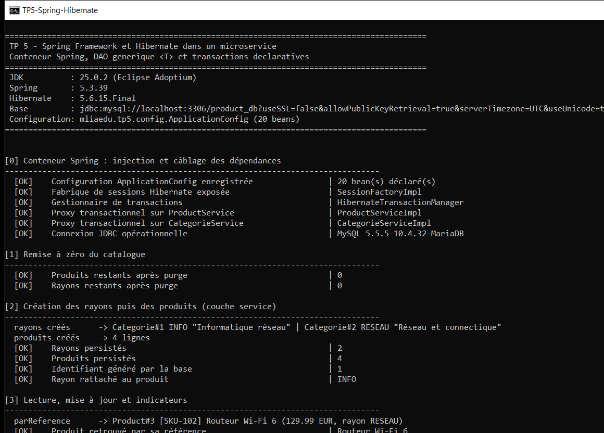
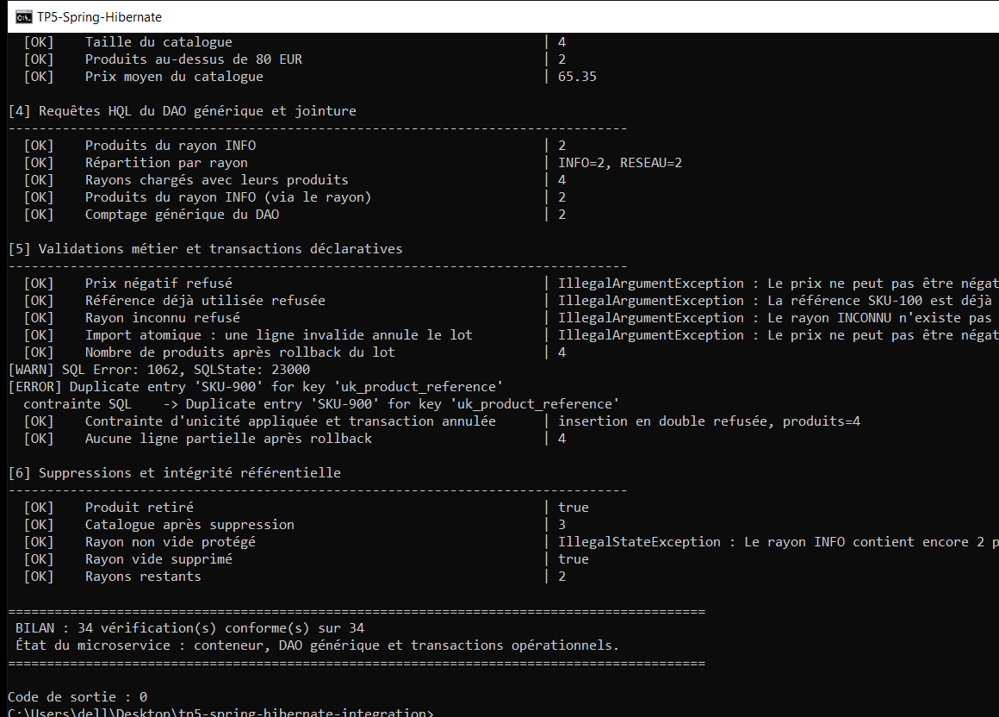

# TP 5 — Intégration de Spring et Hibernate dans une architecture microservices

Confier à **Spring** le câblage des objets (`DataSource`, `SessionFactory`, DAO, services) et
la **gestion déclarative des transactions**, Hibernate ne s'occupant plus que du mapping
objet-relationnel.

## Résultat attendu (exécution réelle)

Début de l'exécution — démarrage du conteneur Spring et vérification du câblage :

Fin de l'exécution — dernières étapes et bilan :

